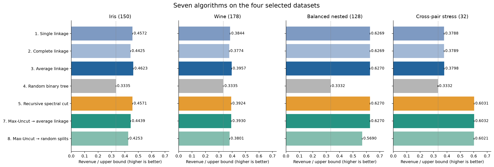

# Selected algorithm experiment results

Seven requested methods on Iris, Wine, balanced nested, and cross-pair stress.
Methods 7 and 8 use one basic-SDP Max-Uncut root bisection (CVXPY/SCS,
best of 32 rounding candidates). Method 7 is the raw root-bisection →
average-linkage construction. It does not choose between this tree and global
average linkage. The basic SDP and spectral sweep are practical heuristics;
these experiments do not establish the certified algorithms' approximation factors.

## Revenue divided by its upper bound

**Table 1** reports the mean normalized revenue $R/U$ for each algorithm and
dataset; higher values indicate better revenue. For each graph, $W=\sum_{i<j}w_{ij}$
and $U=(n-2)W$. Each entry averages algorithm runs within a graph and, for the
synthetic families, then averages equally across the ten graphs. It reports
$R/U$, not $R/\mathrm{OPT}$; since $U$ upper-bounds OPT, this is a conservative
lower bound on the true approximation ratio.

| Algorithm | Iris (150) | Wine (178) | Balanced nested (128) | Cross-pair stress (32) |
|---|---:|---:|---:|---:|
| 1. Single linkage | 0.457227 | 0.384373 | 0.626930 | 0.378752 |
| 2. Complete linkage | 0.442540 | 0.377357 | 0.626949 | 0.378947 |
| 3. Average linkage | 0.462344 | 0.395750 | 0.626973 | 0.379812 |
| 4. Random binary tree | 0.333504 | 0.333472 | 0.333201 | 0.333245 |
| 5. Recursive spectral cut | 0.457108 | 0.392449 | 0.626965 | 0.603140 |
| 7. Max-Uncut → average linkage | 0.443909 | 0.393041 | 0.626973 | 0.603171 |
| 8. Max-Uncut → random splits | 0.425326 | 0.380098 | 0.569038 | 0.602141 |

## Dasgupta cost

**Table 2** reports mean Dasgupta cost $C(T)$ for the same algorithms and datasets;
lower values are better. Synthetic entries use the same two-stage averaging as
Table 1. Costs are comparable between algorithms on one dataset, while their
magnitudes also depend on the dataset size and total similarity weight.

| Algorithm | Iris (150) | Wine (178) | Balanced nested (128) | Cross-pair stress (32) |
|---|---:|---:|---:|---:|
| 1. Single linkage | 554,198.70 | 1,071,393.68 | 131,019.65 | 3,400.75 |
| 2. Complete linkage | 568,831.01 | 1,083,382.12 | 131,013.25 | 3,399.78 |
| 3. Average linkage | 549,101.28 | 1,051,952.34 | 131,005.41 | 3,395.51 |
| 4. Random binary tree | 677,457.05 | 1,158,372.44 | 229,965.72 | 3,625.71 |
| 5. Recursive spectral cut | 554,317.59 | 1,057,592.78 | 131,007.88 | 2,291.47 |
| 7. Max-Uncut → average linkage | 567,467.27 | 1,056,580.62 | 131,005.41 | 2,291.32 |
| 8. Max-Uncut → random splits | 585,980.20 | 1,078,698.38 | 150,521.42 | 2,296.41 |

## Revenue

**Table 3** reports mean Moseley–Wang revenue $R(T)$ in the original weight scale;
higher values are better. It uses the same averaging as Tables 1 and 2. The identity
$C(T)+R(T)=nW$ holds for every tree, so cost and revenue give equivalent rankings
within a fixed dataset; this table shows the unnormalized revenue values.

| Algorithm | Iris (150) | Wine (178) | Balanced nested (128) | Cross-pair stress (32) |
|---|---:|---:|---:|---:|
| 1. Single linkage | 455,511.22 | 656,810.91 | 211,188.52 | 1,872.38 |
| 2. Complete linkage | 440,878.92 | 644,822.46 | 211,194.92 | 1,873.35 |
| 3. Average linkage | 460,608.64 | 676,252.25 | 211,202.76 | 1,877.62 |
| 4. Random binary tree | 332,252.87 | 569,832.15 | 112,242.45 | 1,647.42 |
| 5. Recursive spectral cut | 455,392.33 | 670,611.81 | 211,200.29 | 2,981.66 |
| 7. Max-Uncut → average linkage | 442,242.65 | 671,623.97 | 211,202.76 | 2,981.81 |
| 8. Max-Uncut → random splits | 423,729.72 | 649,506.20 | 191,686.75 | 2,976.72 |

## Variation across synthetic graphs

Both families have ten independently generated graphs. These are means ± sample
standard deviations of the per-graph mean revenue ratios, not confidence intervals
or the standard deviation of all pooled algorithm runs. Plot error bars show these SDs.

| Algorithm | Balanced nested: mean ± SD | Cross-pair: mean ± SD |
|---|---:|---:|
| 1. Single linkage | 0.626930 ± 0.000104 | 0.378752 ± 0.000313 |
| 2. Complete linkage | 0.626949 ± 0.000108 | 0.378947 ± 0.000429 |
| 3. Average linkage | 0.626973 ± 0.000104 | 0.379812 ± 0.000272 |
| 4. Random binary tree | 0.333201 ± 0.000231 | 0.333245 ± 0.002490 |
| 5. Recursive spectral cut | 0.626965 ± 0.000104 | 0.603140 ± 0.000555 |
| 7. Max-Uncut → average linkage | 0.626973 ± 0.000104 | 0.603171 ± 0.000561 |
| 8. Max-Uncut → random splits | 0.569038 ± 0.000185 | 0.602141 ± 0.000518 |

## Sampling and dataset details

- Iris: 150 observations; Wine: 178 observations. Numerical features were
  standardized separately within each dataset, then converted to dense Gaussian
  similarities using the median strictly positive pairwise distance as bandwidth.
  Labels were excluded and the diagonal was set to zero.
- Balanced nested: ten 128-node graphs, generation seeds 4234–4243. Eight leaf groups
  form a balanced three-level hierarchy, with higher weights inside deeper groups;
  independent edge noise has standard deviation 0.02.
- Cross-pair stress: ten 32-node graphs, generation seeds 5000–5009. Each graph has
  two groups of 16 nodes, within-group weights 0.6, a perfect cross-group matching
  of weight 1, and other cross-group weights 0.02, before edge noise of standard
  deviation 0.01 and clipping. This is a deliberately constructed stress test.
- Iris, Wine, and each balanced-nested graph: deterministic methods have one run; random
  binary trees average 100 runs (seeds 4234–4333); methods 7 and 8 average 20 runs
  (seeds 4234–4253).
- Cross-pair stress: deterministic methods run once per graph; random trees and
  methods 7 and 8 average 20 algorithm seeds (0–19) per graph. We first average
  within each graph, then equally across the ten graphs. The ratio column is the
  mean of individual graph ratios. Random results are sampled means, not exact
  expectations. Standalone random splitting uses independent fair coin flips,
  resampling empty splits; the root in method 8 is balanced.

## Provenance and validation

Iris and Wine baseline and root-bisection results were reused. Balanced nested
was rerun on ten graphs using the same seven algorithms, with all 1,440 trees
independently scored using pairwise LCA sizes. Seed 4234 reproduces the original
saved balanced-nested input exactly. Cross-pair baseline results were reused;
missing cross-pair
random subtrees were generated from the saved root partitions in
`results/best_of_validation/diagnostics.json`, with the original algorithm seeds.
All 200 regenerated root-average trees exactly matched their saved tree arrays.
All 400 cross-pair hybrid trees were independently rescored from pairwise LCA
sizes using SciPy. Every compiled score satisfied $C+R=nW$ and the ratio formula.

Generate the balanced-nested results with
`.venv/bin/python scripts/run_balanced_nested_replicates.py`, then rebuild this
comparison with `.venv/bin/python scripts/selected_algorithm_results.py`.
Full scores, per-graph means, summary, tree archives, and input SHA-256 hashes
are in `results/selected_algorithms/`.
